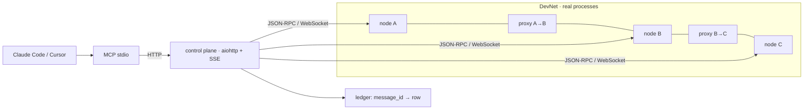
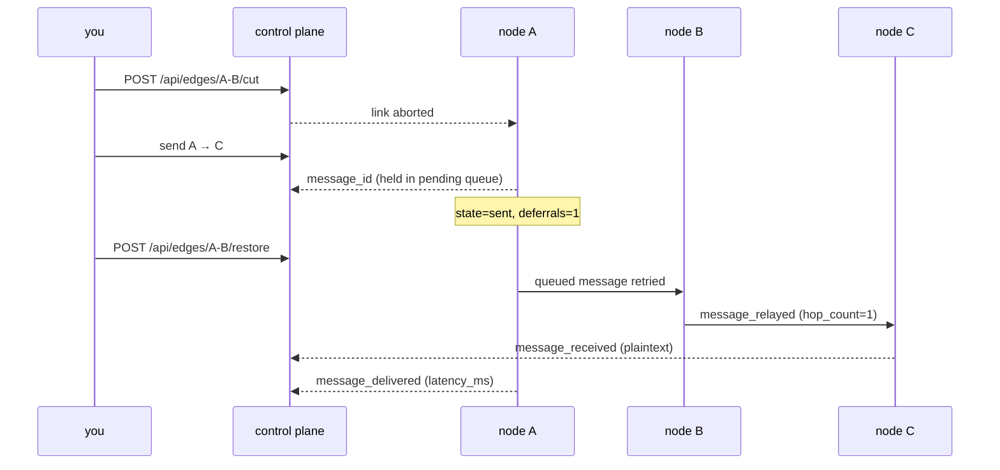

# I built a mesh you can cut: debugging Offline Protocol with real nodes on one laptop

*A devnet, inspector and MCP bridge for Offline Protocol's Mesh SDK — and the four things that only running it could teach me.*

---

Offline Protocol's pitch is the one that makes you open a terminal: messages that travel phone to
phone over BLE and Wi-Fi Direct, no internet, no server, store-and-forward when a link dies. The
SDK is real — MLS encryption, relay hop counts, pending queues, TTLs — and it ships a gateway mode
that runs on Linux and macOS.

Then you try to build something with it.

Every example assumes two devices. The first thing you want to see — *which node relayed my
message, and how long did the hold last when the link dropped* — is the thing the stack is least
equipped to show you. You get logs per process, and a mental model you're not sure is right.

So I built **Meshbench**: a local devnet where each node is the actual `offline-protocol-service`
binary, each link is a TCP proxy you can cut, and every node's event stream folds into one row per
message. One command, no phones.

```
mesh benchmark · chain · 3 nodes
  --------------------------------------------------------------
  A → C   1 hop via B   1192 ms   state=received
  protocol delivered : True
  app accepted       : True
  relay path         : A → B → C
  verdict            : PASS
```

`A` was never told `C`'s address. It only knows `B`. Those numbers come from the SDK's own events.

This post is about the mechanism, and about the four corrections that only running it produced.

## The design in one paragraph

A `DevNet` owns N real service processes. Each gets an isolated MLS root, an isolated state root, a
token file, a local API port, and a peer list. The peer list does not point at other nodes — it
points at **directed TCP proxies**, one per edge direction. Messages are sent by calling the
recipient node's local API (`send_message`). Every node pushes events (`message_sent`,
`message_relayed`, `message_delivered`, `message_received`, `neighbor_lost`, …) over the same
WebSocket, and a ledger folds those events into one row per `message_id`. A small aiohttp control
plane serves a dashboard over SSE and exposes the same actions as JSON, which an MCP stdio server
then hands to an agent.



Two decisions did most of the work.

**Real processes, not a simulation.** I could have modelled a mesh in memory and drawn a nicer
diagram. It would have been wrong in exactly the ways that matter: MLS session setup, duplicate
suppression, deferral, retry timing. Running the binary means every observation is the protocol's
behavior, including the parts I don't understand yet.

**Proxies, not fake links.** A `LinkProxy` accepts a TCP connection and pumps bytes in one
direction. Cutting it aborts live sockets and stops listening. To the SDK that is a radio
disappearing — `neighbor_lost`, queue, retry — not a flag in my code that pretends.

## Correction 1: closing a socket is not a partition

The first version of "cut" closed the listening server and the connections. Then a test failed in a
way I didn't believe: I cut `A-B`, sent `A → C`, and the message arrived in under six seconds.

The cause was a race. The service had already accepted the connection and the send rode a socket
that was dead but not yet *noticed*. The ledger was telling the truth about the protocol and the
truth about my fault injection was that it hadn't happened yet.

The fix is to wait for the partition to be visible on both ends before returning:

```python
if state == "cut":
    await edge.forward.cut()
    await edge.backward.cut()
    edge.state = "cut"
    # Closing sockets is not the same as the SDK noticing. Wait until both
    # ends have actually dropped the peer, otherwise a send issued right
    # after a cut can still ride a half-dead socket and look delivered.
    await self._await_partition(edge)
```

```python
async def _await_partition(self, edge: Edge, timeout: float = 5.0) -> None:
    src, dst = self._node(edge.source), self._node(edge.target)
    if not src or not dst or not src.address or not dst.address:
        return
    deadline = time.time() + timeout
    while time.time() < deadline:
        if dst.address not in src.neighbors and src.address not in dst.neighbors:
            return
        await asyncio.sleep(0.05)
```

A fault injector that returns before the fault exists is worse than no injector: it produces green
tests for a partition that never happened.

## Correction 2: the SDK emits `message_delivered` for traffic that is not your message

The ledger initially showed rows I never sent. Acknowledgements and key-exchange frames also produce
`message_delivered` and `message_relayed` events. If you open a row on any `message_*` event, your
UI fills with ghost messages and your latency stats become fiction.

The rule that fixed it: a row only opens on a real send or a real application receipt.

```python
# Control frames (ack/hello/keying traffic) also emit message_delivered;
# only a real send or a real app receipt opens a ledger row.
if row is None and etype not in {"message_sent", "message_received"}:
    return
```

State advancement is monotonic on a fixed order (`queued → sent → deferred → relayed → delivered →
received → failed`), so an event that arrives out of order can never walk a row backwards. That
matters because with three nodes, ordering is not something you get to assume.

## Correction 3: the wire is ciphertext, the receipt is plaintext

With `require_encryption: true`, the `message_sent` event carries content prefixed `__MLS_ENC__`.
The plaintext appears only at the recipient's `message_received`. Two consequences:

- The ledger shows the sender's preview as empty until the recipient's receipt lands — and that is
  correct, because the sender never had the plaintext on the wire.
- Never "decrypt" anything in the inspector. Showing what the recipient actually accepted is both
  easier and more truthful.

```python
@staticmethod
def _preview(content: Any) -> str:
    text = content if isinstance(content, str) else str(content)
    if text.startswith("__MLS_ENC__"):
        return ""  # ciphertext on the wire; the recipient event carries plaintext
```

## Correction 4: the shutdown deadlock (Python 3.12)

`meshbench demo` passed, then hung on exit, every time. Two instrumentation runs —
`faulthandler.dump_traceback_later(25)` and a watchdog that printed every task stack after 12
seconds — put the hang in the proxy teardown.

Since Python 3.12, `Server.wait_closed()` waits for live connection handlers. Closing the server
before aborting its handlers deadlocks against its own pumps. `cut()` now aborts first, cancels and
awaits handlers, and only then closes the listener with a bounded wait:

```python
async def cut(self) -> None:
    """Close every live connection hard and stop accepting new ones."""
    self.cut_state = True
    # Abort before closing the listener: since 3.12 `wait_closed()` waits on
    # live handlers, so closing the server first deadlocks against its own pumps.
    for _reader, writer in list(self._conns):
        with contextlib.suppress(Exception):
            writer.transport.abort()
    self._conns.clear()
    for task in list(self._handlers):
        task.cancel()
    if self._handlers:
        await asyncio.gather(*list(self._handlers), return_exceptions=True)
    if self._server is not None:
        self._server.close()
        with contextlib.suppress(Exception):
            await asyncio.wait_for(self._server.wait_closed(), 2)
        self._server = None
```

There is a lesson under the lesson: a CLI that hangs on exit is a CLI nobody puts in CI, and CI is
where this thing earns its keep.

## What a partition actually looks like



Measured: held for 10.7 seconds across the cut, delivered on restore with `hops=1`,
`relays=['B']`, no resend from the application. That single number — a message surviving a
partition and arriving through a relay it was never configured to use — is the thing the SDK is
selling, and until this existed I had no way to see it.

Stop a node and start it again and the mesh heals: `A` and `C` re-discover their neighbors without
being restarted. That path needed a nudge — some transports do not re-dial after a hard close, so
the devnet restarts the two ends if the edge hasn't come back after a few seconds. It is a
workaround, and it is documented as one.

## Driving it from an agent

The interesting surface isn't the dashboard; it's the MCP server. Six tools, each returning
evidence rather than `{"ok": true}`:

```python
{
    "name": "mesh_send",
    "description": "Send a message between two devnet nodes and wait for the delivery evidence "
                   "(hop count, relay path, latency, protocol-delivered vs app-accepted).",
    "inputSchema": {
        "type": "object",
        "properties": {
            "from": {"type": "string", "description": "sender node id, e.g. A"},
            "to": {"type": "string", "description": "recipient node id, e.g. C (or a full off1 address)"},
            "content": {"type": "string"},
            "priority": {"type": "string", "enum": ["Low", "Medium", "High", "Critical"]},
            "timeout_s": {"type": "number", "default": 20},
        },
        "required": ["to"],
    },
}
```

An agent can now do what I did by hand: boot a chain, cut a link, send, assert the message is
*held*, restore, send again, assert delivery. That is an integration test for a mesh application
that needs no hardware, and the agent can write it while you watch.

## How I know it works

```bash
MESHBENCH_E2E=1 .venv/bin/pytest -q   # 7 passed
```

Four ledger tests run without the SDK at all (correlation across nodes, ciphertext hiding, latency
backfill when the receipt beats the ack, control frames not polluting the ledger, failure as a
terminal state). Three end-to-end tests spawn real devnets and assert real behavior: chain relay
with `relays == ["B"]`; cut → held → restore → delivered; node restart → both neighbors return.

The end-to-end tests are gated behind `MESHBENCH_E2E=1` because each one takes seconds and spawns
processes. Fast tests that need nothing, honest tests that need everything.

## What I deliberately left out

- **Radios.** No BLE, no Wi-Fi Direct radio. Loopback exercises routing, framing and
  store-and-forward, not RSSI-driven transport selection.
- **A database.** State is in memory, capped, and meant to be watched live — this is a devnet, not
  a telemetry backend.
- **A frontend build.** The dashboard is one static HTML file with canvas and SSE. It ships inside
  the wheel and there is no bundler to break.
- **A universal protocol abstraction.** Meshbench drives Offline Protocol's local API v1
  specifically. `localapi.py` is thin on purpose: when the API moves, one small file moves.

## Next

The obvious next step is **scenario files**: a YAML list of `send` / `wait` / `cut` / `restart` /
`expect` steps, plus a `meshbench assert` that exits non-zero. At that point a mesh app can have a
CI job that says "relayed within two hops, delivered within five seconds, survives one partition"
— which is the difference between a demo and a product.

After that: loss and jitter proxies (the duplicate-suppression behavior is the interesting part),
and a per-message trace export so a slow relay hop shows up in a trace viewer instead of a log.

---

Meshbench is AGPL-3.0-only, because the SDK is. Clone it, run `meshbench demo`, and you have the
numbers in this post on your own machine in about twenty seconds — no phones, no pairing, no
signup.

<sub>Built by [Harish Kotra](https://harishkotra.me) · [Checkout my other builds](https://dailybuild.xyz)</sub>
