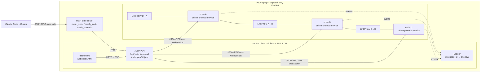
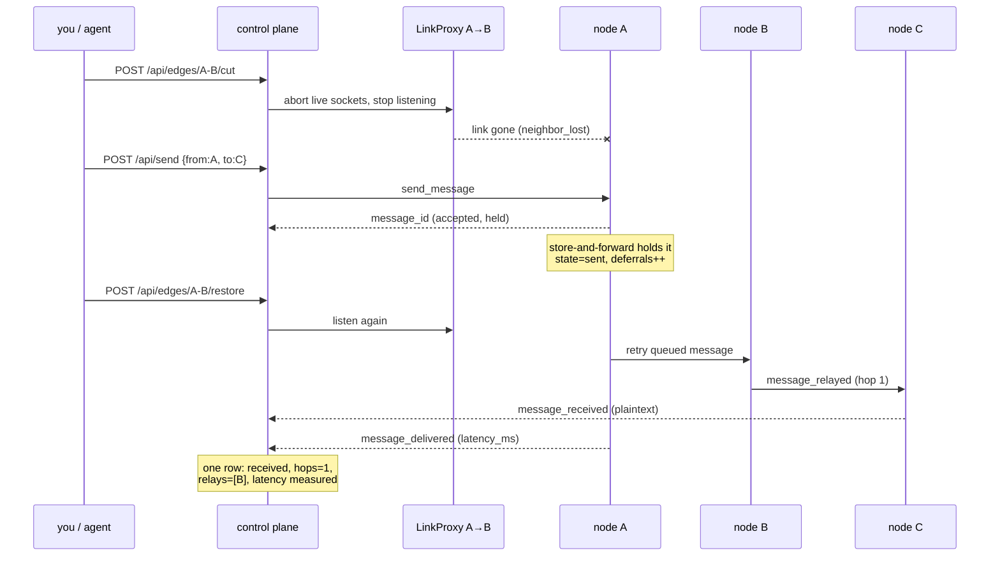

# Meshbench

**A local devnet, live inspector and MCP bridge for [Offline Protocol](https://offlineprotocol.dev) mesh apps — real `offline-protocol-service` processes on loopback, with cuttable links, a per-message ledger, and an agent-facing control surface.**

Offline Protocol's Mesh SDK is built for phones talking over BLE and Wi-Fi Direct. That makes the
first 30 minutes of development awkward: every example needs two devices, and there is no way to
watch routing, see a message bounce between relays, or prove that store-and-forward works when a
link drops.

Meshbench puts the whole mesh on one laptop. Every "node" is the actual SDK service binary with
its own MLS state, its own store, its own token-authenticated local API. Every "link" is a TCP
proxy you can cut. Nothing is mocked, so what you measure here — MLS session setup, encryption,
relay hop counts, retry and deferral behavior — is the protocol's real behavior.

```
mesh benchmark · chain · 3 nodes
  --------------------------------------------------------------
  A → C  off1q8xkfs7f3gft4lvaq2fukdp5s8xmjw2mcv8gfah8  ⇒  off1qy5y3q4kjwvry9n5d8zvw28sehfdjjx9nvwazksw
  --------------------------------------------------------------
  A → C   1 hop via B   1192 ms   state=received
  protocol delivered : True
  app accepted       : True
  relay path         : A → B → C
  verdict            : PASS
```

`A` and `C` are never configured as peers — they only know `B`. The hop count and relay path come
from the SDK's own `message_relayed` / `message_delivered` events, not from Meshbench's guess
about the topology.

## What you get

- **A devnet in one command** — `meshbench up`, with `chain`, `ring`, `star` and `full` topologies.
- **A live dashboard** — topology with animated packets, per-message ledger (state, hops, relay
  path, RTT, transport), event stream, node inspector, click-to-cut links.
- **Fault injection that is a real partition** — cutting an edge closes live sockets and refuses
  new ones, so the SDK genuinely loses its neighbor and falls back to holding messages.
- **A ledger, not four logs** — every node's event stream folds into one row per `message_id`.
- **An MCP server** — Claude Code, Cursor or any coding agent can boot a mesh, send a message, cut
  a link and read back delivery evidence without touching hardware.
- **A test suite that proves the protocol behaviors you rely on** — relay hop counts, deferred
  delivery across a partition, node restart and mesh healing.

## Install

```bash
git clone <your-fork-url> meshbench && cd meshbench
python3 -m venv .venv
.venv/bin/pip install -e ".[sdk,dev]"
.venv/bin/meshbench doctor
```

`doctor` checks the Python version, the installed SDK version, and that the
`offline-protocol-service` binary can be found. The `sdk` extra pulls
`offline-protocol-sdk[lan,http]==0.33.0`, which ships that binary next to your interpreter. If it
lives somewhere unusual:

```bash
export MESHBENCH_SERVICE=/path/to/offline-protocol-service
```

## Quickstart

```bash
# 1. prove a relayed delivery with no dashboard, no config
meshbench demo --nodes 3 --topology chain

# 2. run a devnet and watch it
meshbench up --nodes 4 --topology ring
#    dashboard: http://127.0.0.1:8787

# 3. script it
meshbench status
meshbench send --from A --to C --wait "hello mesh"
meshbench down
```

Everything lives under `--home` (default `.meshbench/`): one directory per node holding its MLS
root, service state, API token file and log, plus the generated `config.json` and the SDK
`store.key`.

### Commands

| Command | What it does |
|---|---|
| `meshbench doctor` | Verify Python, SDK version and the service binary |
| `meshbench up` | Start the devnet + control plane (`--nodes`, `--topology`, `--port`, `--home`) |
| `meshbench down` | Stop every process, print the devnet id that stopped |
| `meshbench status` | Nodes, `off1…` addresses, neighbors, link states, ledger tally |
| `meshbench send` | Send between nodes; `--wait` blocks until delivered/received/failed |
| `meshbench demo` | Boot a throwaway devnet, send first→last, print the proof, exit |
| `meshbench mcp` | Run the stdio MCP server against a home (boots a devnet on demand) |

## Architecture



Three loops make the whole thing work: **processes** (each node is a real service), **proxies**
(each directed edge is a TCP hop you can cut), and **events** (each node's local API pushes
everything that happens, which the ledger folds into one row per message).

### The partition → deferral → delivery loop



## The parts worth reading

### 1. A node is the real service, not a simulation

`meshbench/devnet.py` — each node gets its own MLS root, state root, token file, local API port
and an explicit list of peers. The peer list points at **proxies**, never at the other node:

```python
peers: list[str] = []
for edge in self.edges:
    if edge.source == node.id:
        peers.append(f"{self.host}:{edge.forward.listen_port}")
    elif edge.target == node.id:
        peers.append(f"{self.host}:{edge.backward.listen_port}")
args = [
    self.service_bin,
    "--config", str(self.home / "config.json"),
    "--tcp", str(node.api_port),
    "--token-file", str(node.token_path),
    "--mls-root", str(node.root / "mls"),
    "--state-root", str(node.root / "state"),
    "--listen", f"{self.host}:{node.peer_port}",
    "--no-health",
    "--log-level", "info",
]
for peer in peers:
    args += ["--peer", peer]
env = dict(os.environ)
env["OFFLINE_PROTOCOL_STORE_KEY"] = (self.home / "store.key").read_text().strip()
env["RUST_LOG"] = "warn"
```

Readiness is not "the process started" — it is "the local API answered `hello` and returned its
`off1…` address", so the first command you issue never races startup:

```python
for _ in range(200):
    if node.proc.returncode is not None:
        raise RuntimeError(f"node {node.id} exited early:\n{self._log_tail(node)}")
    if node.token_path.exists() and node.link:
        if await node.link.wait_hello(timeout=0.4):
            return
    await asyncio.sleep(0.1)
```

### 2. A link is a TCP proxy you can cut

`meshbench/proxy.py` — cutting aborts sockets *before* closing the listener, because since Python
3.12 `Server.wait_closed()` waits on live handlers and closing first deadlocks against its own
pumps:

```python
async def cut(self) -> None:
    """Close every live connection hard and stop accepting new ones."""
    self.cut_state = True
    # Abort before closing the listener: since 3.12 `wait_closed()` waits on
    # live handlers, so closing the server first deadlocks against its own pumps.
    for _reader, writer in list(self._conns):
        with contextlib.suppress(Exception):
            writer.transport.abort()
    self._conns.clear()
    for task in list(self._handlers):
        task.cancel()
    if self._handlers:
        await asyncio.gather(*list(self._handlers), return_exceptions=True)
    if self._server is not None:
        self._server.close()
        with contextlib.suppress(Exception):
            await asyncio.wait_for(self._server.wait_closed(), 2)
        self._server = None
```

Closing a socket is not the same as the SDK noticing it, so `set_edge(..., "cut")` waits for the
partition to be visible on both ends before returning. Without this, a send issued immediately
after a cut can ride a half-dead socket and look delivered:

```python
if state == "cut":
    await edge.forward.cut()
    await edge.backward.cut()
    edge.state = "cut"
    # Closing sockets is not the same as the SDK noticing. Wait until both
    # ends have actually dropped the peer, otherwise a send issued right
    # after a cut can still ride a half-dead socket and look delivered.
    await self._await_partition(edge)
```

### 3. Sending is one call to the node's own API

`meshbench/devnet.py` — the message id comes back from the service, and the row is seeded only if
the node's event stream hasn't already produced it:

```python
result = await src.link.call(
    "send_message",
    {"recipient": dst.address, "content": content, "priority": priority},
    timeout=25,
)
message_id = result if isinstance(result, str) else (result or {}).get("message_id")
```

The ledger row is seeded from that send only if no event has opened it yet, so an event that wins
the race is never overwritten by the caller's view of the message.

### 4. The ledger folds four nodes into one row

`meshbench/store.py` — control traffic (acks, keying) also emits `message_delivered`, so a row only
opens on a real send or a real application receipt, and ciphertext never reaches the UI:

```python
mid = rec["message_id"]
row = self.messages.get(mid)
now = rec["ts"]
# Control frames (ack/hello/keying traffic) also emit message_delivered;
# only a real send or a real app receipt opens a ledger row.
if row is None and etype not in {"message_sent", "message_received"}:
    return
```

```python
@staticmethod
def _preview(content: Any) -> str:
    if content is None:
        return ""
    text = content if isinstance(content, str) else str(content)
    if text.startswith("__MLS_ENC__"):
        return ""  # ciphertext on the wire; the recipient event carries plaintext
    return text if len(text) <= 160 else text[:157] + "..."
```

### 5. The handshake that keeps nodes addressable

`meshbench/localapi.py` — the local API is JSON-RPC over a token-authenticated WebSocket. `hello`
returns the node's `off1…` address, which is what makes `send_message` targetable:

```python
async def _hello_exchange(self, ws, token: str) -> None:
    reply = await self._request(ws, "hello", {"app_id": self.app_id, "token": token}, timeout=15)
    self.address = reply.get("local_address") or self.address
    self._hello.set()
```

### 6. The MCP surface is deliberately small

`meshbench/mcp.py` — six tools, each returning evidence rather than status prose:

```python
{
    "name": "mesh_send",
    "description": "Send a message between two devnet nodes and wait for the delivery evidence "
                   "(hop count, relay path, latency, protocol-delivered vs app-accepted).",
    "inputSchema": {
        "type": "object",
        "properties": {
            "from": {"type": "string", "description": "sender node id, e.g. A"},
            "to": {"type": "string", "description": "recipient node id, e.g. C (or a full off1 address)"},
            "content": {"type": "string"},
            "priority": {"type": "string", "enum": ["Low", "Medium", "High", "Critical"]},
            "timeout_s": {"type": "number", "default": 20},
        },
        "required": ["to"],
    },
}
```

| Tool | What it returns |
|---|---|
| `mesh_status` | Devnet, nodes, addresses, neighbors, edges, ledger stats |
| `mesh_peers` | Per-node neighbors and session counts |
| `mesh_send` | `hops`, `relays`, `latency_ms`, `protocol delivered`, `app accepted` |
| `mesh_inbox` | Messages a node actually accepted, newest first |
| `mesh_fault` | Cut/restore an edge; stop/start a node |
| `mesh_scenario` | Boot a devnet if needed, send first→last, return the proof |

Wire it into an agent:

```bash
claude mcp add meshbench -- /absolute/path/.venv/bin/meshbench mcp
```

```json
{
  "mcpServers": {
    "meshbench": {
      "command": "/absolute/path/to/.venv/bin/meshbench",
      "args": ["mcp"],
      "env": { "MESHBENCH_HOME": "/absolute/path/to/repo/.meshbench" }
    }
  }
}
```

An agent loop that actually proves something: `mesh_scenario` → `mesh_fault cut` → `mesh_send`
(assert held) → `mesh_fault restore` → `mesh_send` (assert delivered). That is an integration test
for a mesh app, with no phones in the loop.

## What the runs show

Measured on this machine, `offline-protocol-sdk==0.33.0`, loopback, encryption required:

- **Relay** — chain `A—B—C`, `A → C`: `1 hop via B`, `relays=['B']`. `A` was never told `C`'s
  address; the hop count is the SDK's own.
- **Partition** — cutting `A-B`, sending `A → C` and restoring after ~20 s: the message was held
  (`state=sent`, `deferrals=1`) and delivered through `B` on restore with no resend, `latency_ms`
  recording the full wait (~10.7 s in the automated run, ~32.5 s in the manual one).
- **Isolation** — cutting both links of a ring node makes it unreachable; messages to it stay
  queued, and the dashboard shows the edge as `CUT`.
- **Restart** — stopping `B` and starting it again re-establishes neighbors on both sides and the
  mesh heals without restarting `A` or `C`.

## Tests

```bash
MESHBENCH_E2E=1 .venv/bin/pytest -q
# 7 passed
```

Four ledger tests run without the SDK at all (three nodes folding into one row, ciphertext hidden,
latency backfilled when the receipt beats the ack, control frames ignored, failure as a terminal
state). Three end-to-end tests spawn real devnets and assert real behavior: chain relay, cut →
held → restore → delivered, node restart → mesh heals. They are gated behind `MESHBENCH_E2E=1`
because each one spawns real service processes and takes seconds.

## Configuration

`config.json` is generated in the devnet home and passed to every node:

```json
{
  "app_id": "meshbench",
  "profile": "gateway",
  "ble_enabled": false,
  "wifi_direct_enabled": true,
  "internet_enabled": false,
  "reticulum_enabled": false,
  "nostr_enabled": false,
  "prefer_online": false,
  "initial_ttl": 8,
  "encryption_enabled": true,
  "auto_key_exchange": true,
  "store_pending": true,
  "require_encryption": true,
  "max_pending_per_peer": 64,
  "max_pending_global": 4096,
  "pending_ttl_ms": 86400000,
  "overflow_policy": "DropOldest"
}
```

BLE is off because there is no radio; Wi-Fi Direct framing is what the loopback transports exercise.
Tighter `pending_ttl_ms` or `max_pending_*` values are the cheap way to test overflow and expiry
without waiting a day.

## Technology

| Piece | Choice | Why |
|---|---|---|
| Protocol | `offline-protocol-sdk[lan,http]==0.33.0` | The real mesh: MLS, relay, store-and-forward. No reimplementation, no mocks. |
| Node transport | local API over TCP + token file | Deterministic, scriptable, no GUI pairing. One token per node, read from disk. |
| Link control | `asyncio.start_server` TCP proxies | A cut is a socket abort — indistinguishable from a radio drop to the SDK. |
| Control plane | `aiohttp` + SSE | One process serves the dashboard, JSON API and event stream; no build step. |
| Dashboard | One static HTML file, canvas + SSE | Ships inside the wheel, renders in any browser, no bundler or React toolchain. |
| Agent bridge | Hand-rolled MCP stdio server | JSON-RPC over stdio, no SDK dependency; works with Claude Code and Cursor. |
| Tests | `pytest` + `pytest-asyncio` | Real processes in tests, not fixtures pretending to be a mesh. |
| Licence | AGPL-3.0-only | Inherited from the SDK; keeping it identical avoids a licensing contradiction. |

## Limits — what this does not do

- **No radios.** Loopback only. Transport *selection* is exercised; RSSI-driven behavior, BLE MTU
  effects and real Wi-Fi Direct negotiation are not.
- **One host.** All nodes share a machine and a clock, so latency here is loopback latency plus
  protocol work, not radio latency.
- **Local API only.** It drives the documented local API; behavior that only exists on the mobile
  SDKs (background wakeups, app lifecycle) is out of scope.
- **Version-pinned.** Written against `offline-protocol-sdk==0.33.0` local API v1. A future API
  change breaks `localapi.py` first, by design — that file is thin.
- **Dashboard is read-mostly.** The JSON API and MCP tools are the scriptable surfaces; the UI is
  for watching and for the occasional click-to-cut.

## Fork and contribute

```bash
git clone https://github.com/<you>/meshbench && cd meshbench
python3 -m venv .venv && .venv/bin/pip install -e ".[sdk,dev]"
.venv/bin/meshbench doctor
.venv/bin/pytest -q                      # 4 fast ledger tests
MESHBENCH_E2E=1 .venv/bin/pytest -q      # + 3 real-process tests
```

Conventions that keep this repo honest:

- **No mocks for protocol behavior.** If a test claims a delivery, it must come from a real service
  process. Stub the clock or the transport only when the thing under test is Meshbench itself.
- **Evidence over assertions in tool output.** New MCP tools should return hops, relay path,
  latency and accepted-versus-delivered, not `{"ok": true}`.
- **Every fault is reversible.** If you add an injector, add its restore path in the same PR and
  test the round trip.
- **Reads and writes stay separated.** `store.py` never touches a socket; `devnet.py` never parses
  SDK events. Keep it that way and the ledger stays testable without processes.
- **Keep the surface small.** Six MCP tools is a feature. A new one needs a use case that the
  existing six cannot express.

### Feature ideas, in rough order of usefulness

1. **Scenario files** — a YAML/JSON list of steps (`send`, `wait`, `cut`, `restart`, `expect`) so a
   mesh integration test is data, not Python. This is the biggest lever: it turns Meshbench from a
   toy into CI infrastructure.
2. **A `meshbench assert` command** — exit non-zero on a failed expectation, so GitHub Actions can
   run "relayed in ≤2 hops, delivered in ≤5 s, survives one partition" without a test file.
3. **Packet loss and jitter proxies** — beyond cut/restore: drop 20% of frames, add 200 ms ± jitter,
   reorder. The SDK's retry and duplicate-suppression behavior is the interesting part.
4. **Deterministic virtual clock** — compress `pending_ttl_ms` expiry tests to seconds by advancing
   a fake clock the ledger and proxies share.
5. **Topology fuzzing** — boot N nodes with random links, drop random edges, and report which
   messages still arrive. Useful for finding routing assumptions before they reach phones.
6. **Trace export** — one `.json`/OTel span per message with per-node timestamps, so a slow relay
   hop is visible in a trace viewer instead of a log.
7. **Dashboard timeline** — scrub a 60-second window and replay packets for a given `message_id`.
8. **Second SDK target** — a driver interface so the same ledger/UI can drive the mobile SDKs via
   their own local API, keeping Meshbench the front end rather than the protocol.

### Pull requests

Small, focused, with a test that fails before the change and the real output in the description.
Include the command you ran and the numbers it printed. If a change touches `proxy.py` or
`localapi.py`, say what happened to shutdown timing — both files have had one deadlock each, and
both were found by running the demo, not by reading it.

## License

AGPL-3.0-only, matching the Offline Protocol SDK's license.

<sub>Built by [Harish Kotra](https://harishkotra.me) · [Checkout my other builds](https://dailybuild.xyz)</sub>
